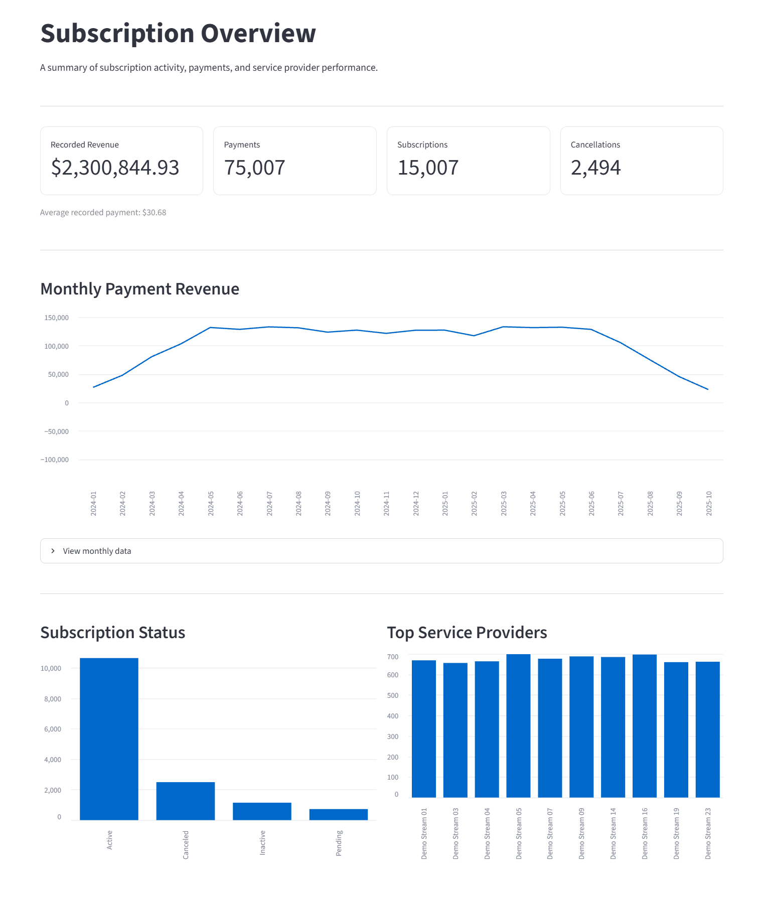
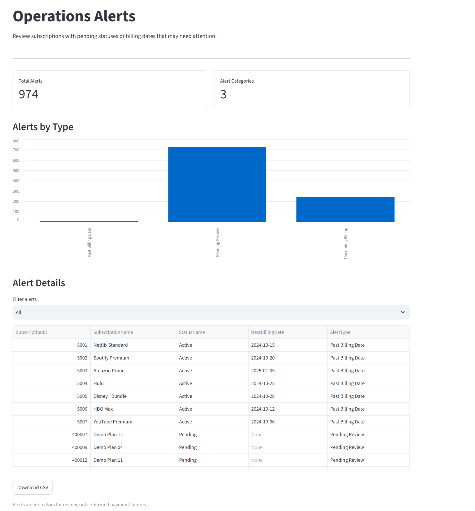
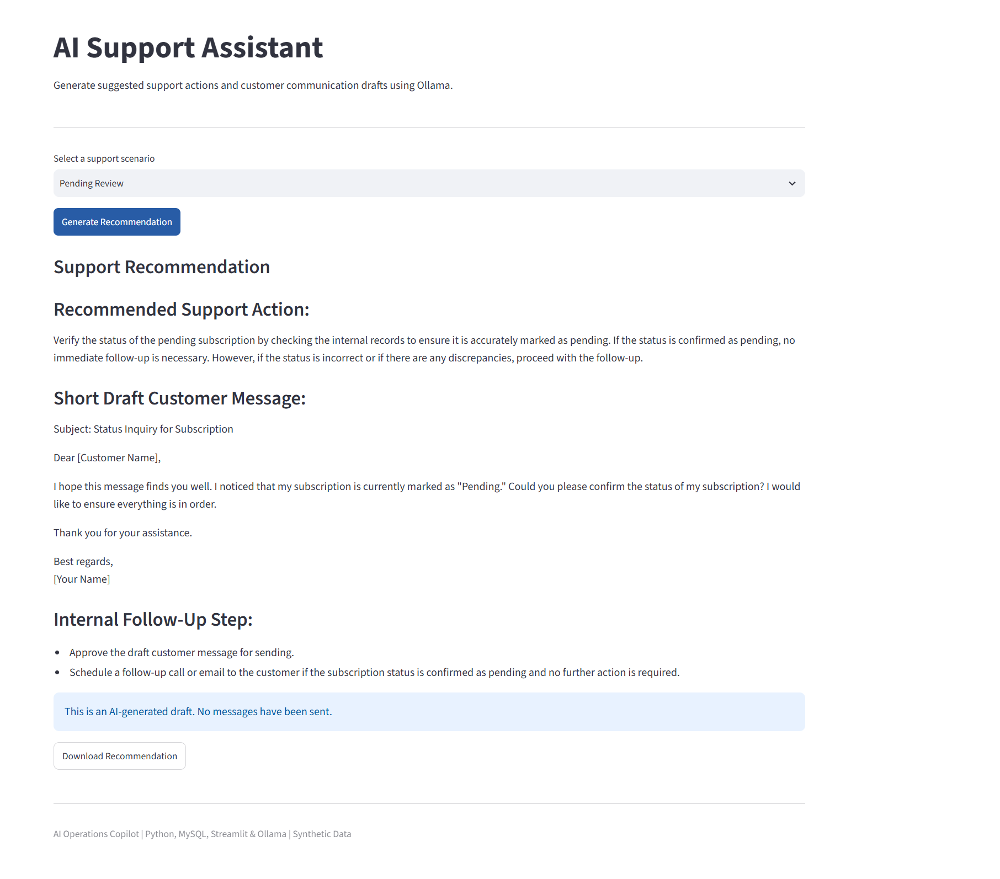

# Subscription AI Operations Copilot

A Python-based application that combines SQL analytics, subscription monitoring, and AI-assisted customer support using MySQL, Streamlit, and Ollama.

This project builds on my Subscription Management database by adding interactive business analytics, operational alerts, and a locally hosted AI assistant.

## Project Overview

Subscription AI Operations Copilot explores how relational databases, business intelligence, and generative AI can work together to support everyday business operations.

The application uses a synthetic subscription dataset containing **176,003 records across 16 MySQL tables**.

It provides dashboards for payment and subscription analysis, identifies accounts requiring operational review, and generates AI-assisted business explanations and customer support recommendations.

The goal was to extend an existing SQL project into a practical application that connects data analysis with AI-powered workflows.


## Application Screenshots

### Subscription Analytics Dashboard


### AI Business Analyst


### Operations Alert Center


### AI Customer Support Assistant


## Key Features

### Business Analytics

- Analyze recorded payment revenue and transaction activity.
- Monitor subscription statuses and cancellations.
- Visualize monthly payment trends.
- Compare subscription counts across service providers.
- Explore SQL results through an interactive Streamlit dashboard.

### AI Business Assistant

- Integrates the Qwen 2.5 3B language model through Ollama.
- Supports four predefined business questions.
- Retrieves verified results directly from MySQL.
- Generates AI-assisted business interpretations.
- Separates SQL-calculated figures from AI-generated explanations.

### Operations Alert Center

- Identifies subscriptions marked as pending.
- Flags active subscriptions with upcoming billing dates.
- Highlights active subscriptions with past billing dates.
- Displays alerts by category.
- Supports filtering and CSV downloads.

The alerts identify records for review. They do not automatically indicate failed payments.

### AI Customer Support Assistant

- Generates recommended support actions.
- Creates draft customer communications.
- Suggests internal follow-up procedures.
- Supports pending subscription and billing-related scenarios.
- Uses locally hosted AI without a paid API.

Recommendations are drafts only. No emails are automatically sent or customer accounts modified.

## Technologies Used

| Technology | Purpose |
|------------|---------|
| Python | Application logic and data processing |
| MySQL | Relational database |
| SQL | Business queries and analytics |
| Pandas | Data manipulation |
| Streamlit | Interactive web dashboard |
| Ollama | Local AI model execution |
| Qwen 2.5 3B | AI-generated explanations and support recommendations |
| Git & GitHub | Version control and project documentation |


## How the Application Works

The application connects to my existing MySQL subscription database through Python.

Streamlit provides the interface for viewing analytics, checking subscription alerts, and using the AI assistant.

The project is organized into five main Python files:

- `database.py` connects the application to MySQL.
- `app.py` handles the dashboard, charts, and navigation.
- `ai_agent.py` runs SQL queries and uses Ollama to explain the results.
- `operations.py` identifies subscriptions that may need attention based on billing dates and statuses.
- `support_agent.py` uses Ollama to generate customer support recommendations and draft messages.

SQL handles the actual data calculations, while Ollama is used for explanations and support recommendations.

```

## Project Results

The synthetic dataset and application demonstrate the following:

| Metric | Result |
|--------|--------|
| Total database records | 176,003 |
| Database tables | 16 |
| Payment records | 75,007 |
| Subscriptions | 15,007 |
| Recorded payment revenue | $2,300,844.93 |
| Subscriptions with cancellation dates | 2,494 |
| Operational alerts identified | 974 |
| Supported business questions | 4 |
| AI support scenarios | 3 |

These figures come from the synthetic dataset and are not real company performance results. Alert counts depend on the billing dates and the date the application is run.

## Project Structure

```text
subscription-ai-operations-copilot/
|
|-- app.py
|-- database.py
|-- ai_agent.py
|-- operations.py
|-- support_agent.py
|-- requirements.txt
|-- .env.example
|-- .gitignore
|-- README.md
|
|-- screenshots/
    |-- overview.png
    |-- ai_analyst.png
    |-- operations_alerts.png
    |-- support_assistant.png
```

### Main Python Files

- `app.py` - Streamlit dashboard and user interface.
- `database.py` - MySQL database connection.
- `ai_agent.py` - SQL-based business questions and local AI explanations.
- `operations.py` - Subscription alert rules.
- `support_agent.py` - AI-generated customer support recommendations.

## Running the Project Locally

### Requirements

- Python
- MySQL Server
- Ollama
- The synthetic Subscription Management dataset

The database is maintained separately from this application repository.

### 1. Clone the Repository

```bash
git clone https://github.com/odewumic26/subscription-ai-operations-copilot.git
cd subscription-ai-operations-copilot
```

### 2. Install Python Dependencies

```bash
python -m pip install -r requirements.txt
```

### 3. Configure MySQL

Create or import the existing Subscription Management database using the name:

```sql
subscription_portfolio
```

Create a `.env` file using `.env.example` as a template.

```ini
DB_USER=your_mysql_username
DB_PASSWORD=your_mysql_password
```

Never commit your actual `.env` file to GitHub.

### 4. Install and Start Ollama

Download Ollama from:

https://ollama.com/download

Download the required model:

```bash
ollama pull qwen2.5:3b
```

Make sure Ollama is running locally.

### 5. Start the Application

```bash
python -m streamlit run app.py
```

Open the local application in your browser:

http://localhost:8501

## Design Considerations

### Data Accuracy

The application separates verified SQL results from language-model-generated explanations.

Financial values are calculated using SQL and Python rather than relying on AI-generated calculations.

### Operational Monitoring

Alerts are generated using predefined SQL conditions. A past billing date or pending status is treated as a reason for review, not proof of a failed transaction.

### AI-Assisted Support

The support assistant creates suggested actions and draft messages. These outputs require human verification and are not automatically sent to customers.

### Local AI

Ollama runs the language model locally, allowing the application to generate responses without a paid AI API.

## Current Limitations

- The business assistant supports predefined SQL questions rather than unrestricted natural-language-to-SQL generation.
- AI explanations may be incomplete or inaccurate.
- Support recommendations are drafts, not automated customer service actions.
- The application depends on a locally running MySQL database and Ollama server.
- The complete application is not yet deployed as a public web service.
- The database records are synthetic and are intended for demonstration purposes.

## Future Improvements

Potential extensions include:

- Natural-language-to-SQL querying with query validation.
- Subscription-level AI support recommendations.
- More detailed operational performance metrics.
- Expanded alert prioritization and tracking.
- Public deployment with a cloud-compatible data and AI architecture.

## Related Project

**Subscription Management Database**

The underlying MySQL database project, including its synthetic data engineering work, is available here:

https://github.com/odewumic26/subscription_management

## About This Project

I developed this portfolio project to build on my background in data analytics and SQL while gaining practical experience integrating AI into business applications.

It demonstrates how structured data, analytics dashboards, automation rules, and locally hosted language models can be combined into a single workflow.

The project is intended for learning and portfolio demonstration, not production customer or payment processing.
